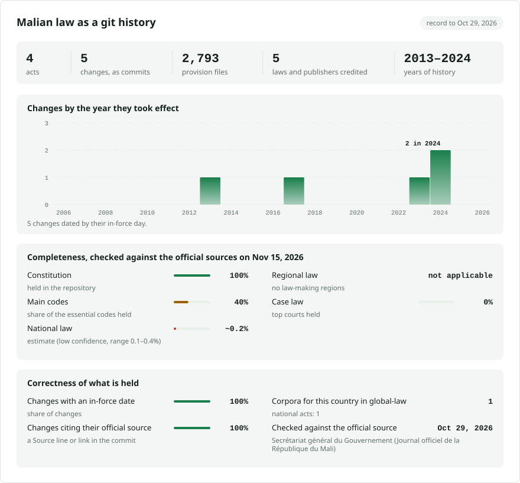

# Mali: law history in git

[Français](README.md) · **English**

<picture>
<source media="(prefers-color-scheme: dark)" srcset="data/effort-dark.svg">

</picture>

The law of Mali as a git history: one file per article, one commit per law on the day it took effect, and the law that made each change as the commit's author. `git blame` names the law behind every paragraph; `git log` lists every change to an article; picking a date gives the text in force that day.

Part of [lexifina/global-law](https://github.com/lexifina/global-law), one git history for every country's law: this is Mali's national law, which global-law reads at `mali/national/acts/`.

**What is in it now:** four acts, with 5 versions in all, each read from the Journal officiel: the Constitution of 22 July 2023 (the preamble and 191 articles, one version); Loi n°2013-015 of 21 May 2013 on personal data (69 articles, two versions: as enacted, and as amended by Loi n°2017-070 of 18 December 2017); and the Code pénal and the Code de procédure pénale of 13 December 2024 (Lois n°2024-027 and n°2024-028; 1,125 and 1,399 articles, one version each). No later change to any of them appears in the issues searched, up to 20 October 2026, so each is today's text.

Each act is a folder, `constitution/`, `donnees-personnelles/`, `code-penal/` and `code-procedure-penale/`, with one file per article (`donnees-personnelles/art-021.md` is Article 21 of the personal data law, on the members of the data protection authority); its `README.md` lists every article and when it changed, and its `plan.md` gives the headings. The Code pénal numbers articles Livre-Titre-Chapitre, then article (`art-0111-001.md` is Article 111-1); Livre V prints 511-1, 511-2 and 512-1 to 512-9 twice, so those files carry their Titre (`art-0511-001-titre-i.md`, `art-0511-001-titre-xi.md`).

The text is in French, as the Journal officiel prints it. An English translation is not part of this record.

## Questions as git commands

| Question | Command |
| --- | --- |
| Every change to Article 21 of the personal data law | `git log -p --word-diff -- donnees-personnelles/art-021.md` |
| Which law wrote each line of Article 21? | `git blame donnees-personnelles/art-021.md` |
| Every version of Article 21, with the day each took effect | `git log --format="%h %(trailers:key=In-force,valueonly,separator=) %an" -- donnees-personnelles/art-021.md` |
| Article 21 as in force on 1 January 2015 | `python tools/on.py 2015-01-01 donnees-personnelles art-021` |

**Outside git**, we also host this record publicly, for free:

- **[Ask Claude about Malian law](https://global-law.lexifina.com/v1/try_claude?country=mali)**: opens Claude with a first question ready.
- **[Ask ChatGPT](https://global-law.lexifina.com/v1/try_chatgpt?country=mali)**: the same question in ChatGPT.
- **[Search Malian law on our site](https://lexifina.com/law?country=mali&q=donn%C3%A9es+%C3%A0+caract%C3%A8re+personnel)**: a search for "données à caractère personnel" (personal data), with each provision's text and its versions, no account needed.
- **[Developer REST API](https://global-law.lexifina.com/v1/search_law?query=donn%C3%A9es+%C3%A0+caract%C3%A8re+personnel&jurisdiction=mali)**: the same search as JSON, with no key. See the [documentation here](https://lexifina.com/api/global-law).

Both assistants read the record through the free Global law connector (MCP, `https://global-law.lexifina.com/mcp`); the first time, the chat gives you the link that adds it. Ask in French or in English.

**Host it yourself easily.** All it takes is git and Python, and the tools run on your machine:

```sh
git clone --depth 1 https://github.com/lexifina/global-law && cd global-law
python3 tools/countries.py add mali/national/acts
python3 tools/law.py show 2026-01-01 mali/national/acts/donnees-personnelles/art-021.md
```

Opened in Claude Code, Cursor, VS Code or Codex, the clone also starts a local MCP server with the same tools ([MCP.md](https://github.com/lexifina/global-law/blob/main/MCP.md)).

## Dates

Each commit is dated at noon, Africa/Bamako (UTC), on the day the version took effect, and carries it in its `In-force:` trailer:

- no Malian text read for this build sets a general delay between publication and entry into force, and the Constitution (art. 116) requires laws to be published in the Journal officiel, so each version is dated by the Journal officiel issue that printed it, unless the law fixes its own date (none of these does);
- the Constitution is dated 22 July 2023, the day of its promulgation decree (Décret n°2023-0401/PT-RM) and of Journal officiel spécial n°13, which printed it; it was adopted by the referendum of 18 June 2023;
- Loi n°2013-015 is dated 28 June 2013 (Journal officiel n°26) and Loi n°2017-070 29 December 2017 (n°53); the two codes are dated 13 December 2024, the day of their promulgation and of Journaux officiels spéciaux n°21 and n°22.

Each change is credited to the law that made it (`Loi n°2017-070`), with an address that cannot exist, so `git blame` and `git log --author` name laws; the first commit of each act is the act as enacted, credited to the act itself. Loi n°2017-070, art. 1er, names the five articles it replaces in full (21, 25, 36, 42 and 49), so nothing is credited to the publisher. Tags `law/<key>` mark each law's commit (`git show law/loi-2017-070`); the committer is always Lexifina.

## How it is checked

- `tools/check_repo.py` reads every version back from git on the day it took effect and on the day before, and both must match the corpus the history was built from; it also checks that every commit's trailers parse, that there are no merge commits and that no commit is dated in the future. The results are in [`REPRODUCE.md`](REPRODUCE.md); a second build has not yet been compared.
- For each act, every character of the issue's text layer from the promulgation formula to the signature (spaces and line-end hyphens aside) is in exactly one file, in the order printed.
- The Constitution's second printing (Journal officiel n°20 of 4 August 2023) gives identical files, and the SGG's "Codes en vigueur" copies of the Code pénal and the Code de procédure pénale give text identical to the Journal officiel (`tools/parse_cpp.py --check` for the latter).
- Every Journal officiel issue listed on sgg-mali.ml up to 20 October 2026 was searched for amendments to the four acts; the only one found is Loi n°2017-070.
- [vulnerabilities/](vulnerabilities/README.en.md): possible drafting mistakes in this law, found by global-law's detectors and checked by hand. Not run yet.

## What it does not show

- **The rest of Malian law.** Only these four acts are here: no other law, ordinance or decree, and no case law.
- **Earlier texts.** The Constitution of 25 February 1992 and the Code pénal of 2001 (Loi n°01-079) are not in the history; each act starts with its text as enacted.
- **Four files that could not be read.** Journal officiel n°2020-23 (25 September 2020) and n°2021-04 (29 January 2021) answer 404 on sgg-mali.ml, and the two files listed as n°2024-32 (8 and 19 September 2024) are not valid PDFs. An amendment to Loi n°2013-015 printed only in one of them, or to the Constitution printed only in the 2024 files, would be missed.
- **Implied repeals.** Loi n°2017-070 (art. 2) and the Code pénal (art. 702-1) repeal "toutes dispositions antérieures contraires" without naming any text; such repeals are not applied.
- **Scans, signatures and tables of contents.** Only text layers are read, with no OCR (every issue used has one); signatures, promulgation formulas and the tables of contents annexed to the two codes are left out.

## Sources

| Source | Kind | Past versions | Notes |
| --- | --- | --- | --- |
| [Journal officiel de la République du Mali](https://sgg-mali.ml/fr/journal-officiel/le-journal-officiel.html) (Secrétariat général du Gouvernement) | Official gazette, one PDF per issue with a text layer (1997 to 2026) | as printed; Mali publishes no dated consolidated versions | Every text; the issues from May 2013 to October 2026 were searched for amendments |
| ["Codes en vigueur"](https://sgg-mali.ml/fr/journal-officiel/les-codes-consolides.html) (the same site) | Current codes as PDFs | no, current text only | Cross-check of the Code pénal and the Code de procédure pénale |

## Licence

See [`LICENSE`](LICENSE). The text is the Journal officiel's, reproduced with the attribution LICENSE gives; sgg-mali.ml states no licence, and whether Malian copyright law excludes official legislative texts from protection has not been verified. The history, commit messages, tables and tools are CC0 1.0.

No AI model wrote, translated or corrected legal text, and none runs when the history is built; the scripts were written by an AI model (see [`REPRODUCE.md`](REPRODUCE.md)).

## Visualisations

- [visualisations/](visualisations/README.en.md): charts drawn from this repository. Not drawn yet.

## More

From [lexifina/global-law](https://github.com/lexifina/global-law):

- [FEATURES.md](https://github.com/lexifina/global-law/blob/main/FEATURES.md): every feature, and what every corpus must support (`git blame`, `law.py`, the MCP tools)
- [FAQ.md](https://github.com/lexifina/global-law/blob/main/FAQ.md): questions and answers · [CONTRIBUTING.md](https://github.com/lexifina/global-law/blob/main/CONTRIBUTING.md): proposing changes · [MCP.md](https://github.com/lexifina/global-law/blob/main/MCP.md): the MCP server · [REPRODUCE.md](https://github.com/lexifina/global-law/blob/main/REPRODUCE.md): how it was built · [CHANGELOG.md](https://github.com/lexifina/global-law/blob/main/CHANGELOG.md)
- [FRESHNESS.md](https://github.com/lexifina/global-law/blob/main/FRESHNESS.md): how current each corpus is · [Monitoring](https://github.com/lexifina/global-law/tree/main/monitoring): whether updates are running · [WATCHING.md](https://github.com/lexifina/global-law/blob/main/WATCHING.md): how each official source is watched for changes
- [performance/](https://github.com/lexifina/global-law/tree/main/performance): how fast the tools are, measured
- [visualisations/](https://github.com/lexifina/global-law/tree/main/visualisations): charts and bridges across the world's law
- [Vulnerabilities](https://github.com/lexifina/global-law/tree/main/vulnerabilities): mistakes in legislation as published
