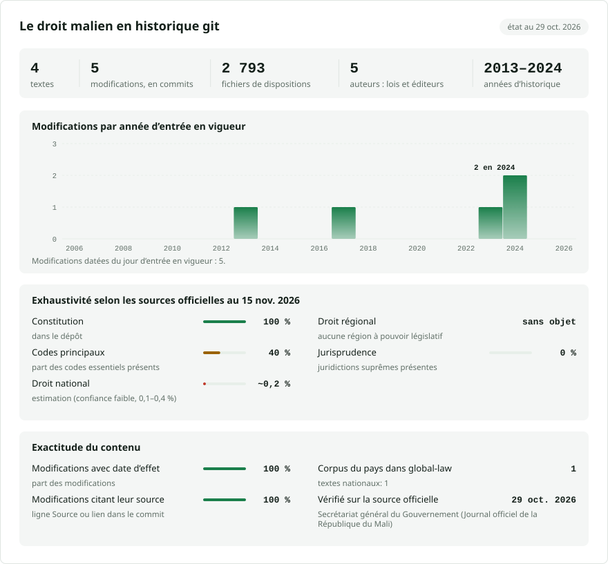

# Mali : l’histoire du droit dans git

**Français** · [English](README.en.md)

<picture>
<source media="(prefers-color-scheme: dark)" srcset="data/fr/effort-dark.svg">

</picture>

Le droit du Mali sous la forme d’un historique git : un fichier par article, un commit par loi à la date de son entrée en vigueur, et la loi auteur de chaque modification comme auteur du commit. `git blame` indique la loi à l’origine de chaque alinéa ; `git log` liste toutes les modifications d’un article ; le choix d’une date donne le texte en vigueur ce jour-là.

Fait partie de [lexifina/global-law](https://github.com/lexifina/global-law), un historique git unique pour le droit de tous les pays : il s’agit ici du droit national du Mali, que global-law lit sous `mali/national/acts/`.

**Contenu actuel :** le Journal officiel de 1997 à novembre 2026, texte par texte : 1 281 lois, 656 ordonnances, 3 929 décrets et 1 488 arrêtés réglementaires (les actes individuels, nominations, autorisations, agréments, ne sont pas repris), chacun tel que publié ; la Constitution du 22 juillet 2023 ; les codes, dont le Code pénal et le Code de procédure pénale de 2024, le Code des personnes et de la famille de 2011, le Code du travail et le Code de procédure civile, commerciale et sociale (versions consolidées du SGG), le Code général des impôts, le Code des douanes, le Code minier et le Code des collectivités territoriales. Aucune jurisprudence. Détail des dossiers : [STRUCTURE.md](STRUCTURE.md).

Chaque texte est un dossier rangé par nature et par année (`lois/2017/2017-061-…/`, `decrets/2005/…`, `codes/<code>/`), avec un fichier par article (`lois/2013/2013-015-portant-protection-des-donnees-a-caractere-personnel/art-021.md` est l’article 21 de la loi relative aux données à caractère personnel) ; son `README.md` donne la source et la date retenue. Les codes de plus de 990 articles sont rangés par Livre (`codes/code-penal/livre-1/art-0111-001.md` est l’article 111-1 du Code pénal).

Le texte est en français, tel que l’imprime le Journal officiel. Une traduction anglaise ne fait pas partie de ce corpus.

## Questions sous forme de commandes git

| Question | Commande |
| --- | --- |
| Toutes les modifications de l’article 21 de la loi relative aux données à caractère personnel | `git log -p --word-diff -- lois/2013/2013-015-portant-protection-des-donnees-a-caractere-personnel/art-021.md` |
| Quelle loi a rédigé chaque ligne de l’article 21 ? | `git blame lois/2013/2013-015-portant-protection-des-donnees-a-caractere-personnel/art-021.md` |
| Toutes les versions de l’article 21, avec la date d’entrée en vigueur de chacune | `git log --format="%h %(trailers:key=In-force,valueonly,separator=) %an" -- lois/2013/2013-015-portant-protection-des-donnees-a-caractere-personnel/art-021.md` |
| L’article 21 tel qu’en vigueur au 1er janvier 2015 | `git log -1 --before=2015-01-02 -p -- lois/2013/2013-015-portant-protection-des-donnees-a-caractere-personnel/art-021.md` |

**En dehors de git**, nous hébergeons aussi ce corpus publiquement, gratuitement :

- **[Interroger Claude sur le droit malien](https://global-law.lexifina.com/v1/try_claude?country=mali)** : ouvre Claude avec une première question prête.
- **[Interroger ChatGPT](https://global-law.lexifina.com/v1/try_chatgpt?country=mali)** : la même question dans ChatGPT.
- **[Rechercher dans le droit malien sur notre site](https://lexifina.com/law?country=mali&q=donn%C3%A9es+%C3%A0+caract%C3%A8re+personnel)** : une recherche de « données à caractère personnel », avec le texte de chaque disposition et ses versions, sans compte.
- **[API REST pour développeurs](https://global-law.lexifina.com/v1/search_law?query=donn%C3%A9es+%C3%A0+caract%C3%A8re+personnel&jurisdiction=mali)** : la même recherche au format JSON, sans clé. Voir la [documentation ici](https://lexifina.com/api/global-law).

Les deux assistants lisent le corpus au moyen du connecteur gratuit Global law (MCP, `https://global-law.lexifina.com/mcp`) ; la première fois, la conversation vous donne le lien qui l’ajoute. Posez vos questions en français ou en anglais.

**L’héberger vous-même, simplement.** Il suffit de git et de Python, et les outils s’exécutent sur votre machine :

```sh
git clone --depth 1 https://github.com/lexifina/global-law && cd global-law
python3 tools/countries.py add mali/national/acts
python3 tools/law.py show 2026-01-01 mali/national/acts/lois/2013/2013-015-portant-protection-des-donnees-a-caractere-personnel/art-021.md
```

Ouvert dans Claude Code, Cursor, VS Code ou Codex, le clone démarre aussi un serveur MCP local doté des mêmes outils ([MCP.md](https://github.com/lexifina/global-law/blob/main/MCP.md)).

## Dates

Chaque commit est daté à midi, heure Africa/Bamako (UTC), du jour où la version est entrée en vigueur, et porte cette date dans son trailer `In-force:` :

- aucun texte malien lu pour cette construction ne fixe de délai général entre la publication et l’entrée en vigueur, et la Constitution (art. 116) exige que les lois soient publiées au Journal officiel ; chaque texte est donc daté du numéro du Journal officiel qui l’a publié, sauf s’il fixe lui-même sa date (dès sa signature, ou un jour donné) ; un texte qui fixe une autre règle est mis de côté ; les versions consolidées du Code du travail et du Code de procédure civile, commerciale et sociale sont datées du Journal officiel du dernier texte modificatif qu’elles intègrent ;
- la Constitution est datée du 22 juillet 2023, jour de son décret de promulgation (Décret n°2023-0401/PT-RM) et du Journal officiel spécial n°13, qui l’a publiée ; elle a été adoptée par le référendum du 18 juin 2023 ;
- la Loi n°2013-015 est datée du 28 juin 2013 (Journal officiel n°26) et la Loi n°2017-070 du 29 décembre 2017 (n°53) ; les deux codes sont datés du 13 décembre 2024, jour de leur promulgation et des Journaux officiels spéciaux n°21 et n°22.

Chaque modification est attribuée à la loi qui l’a opérée (`Loi n°2017-070`), sous une adresse qui ne peut pas exister, de sorte que `git blame` et `git log --author` désignent des lois ; le premier commit de chaque texte est le texte tel qu’adopté, attribué au texte lui-même. La Loi n°2017-070, en son article 1er, désigne les cinq articles qu’elle remplace intégralement (21, 25, 36, 42 et 49) ; rien n’est donc attribué à l’éditeur. Les étiquettes `law/<key>` signalent le commit de chaque loi (`git show law/loi-2017-070`) ; le committer est toujours Lexifina.

## Méthode de vérification

- `tools/check_repo.py` relit chaque version dans git le jour de son entrée en vigueur et la veille, et les deux doivent correspondre au corpus à partir duquel l’historique a été construit ; il vérifie aussi que les trailers de chaque commit sont analysables, l’absence de commits de fusion et qu’aucun commit n’est daté dans le futur. Les résultats figurent dans [`REPRODUCE.md`](REPRODUCE.md) ; une seconde construction n’a pas encore été comparée.
- Pour chaque texte, chaque caractère de la couche texte du numéro, de la formule de promulgation à la signature (espaces et traits d’union de fin de ligne mis à part), se trouve dans un seul fichier, dans l’ordre imprimé.
- La seconde publication de la Constitution (Journal officiel n°20 du 4 août 2023) donne des fichiers identiques, et les copies du Code pénal et du Code de procédure pénale figurant dans les « Codes en vigueur » du SGG donnent un texte identique à celui du Journal officiel (`tools/parse_cpp.py --check` pour ce dernier).
- Tous les numéros du Journal officiel répertoriés sur sgg-mali.ml jusqu’au 20 octobre 2026 ont été consultés pour y rechercher des modifications des quatre textes de la première construction ; la seule trouvée est la Loi n°2017-070.
- [vulnerabilities/](vulnerabilities/): erreurs de rédaction possibles dans ce droit, trouvées par les détecteurs de global-law et vérifiées à la main. Pas encore lancé.

## Ce qu’il ne montre pas

- **Les numéros numérisés et la jurisprudence.** 168 numéros du Journal officiel, surtout de 1997 à 2004, ne sont que des images sans couche texte et ne sont pas lus (pas d’OCR) ; environ 350 textes sont mis de côté (rectificatifs, date illisible, règle d’entrée en vigueur propre). Aucune jurisprudence.
- **Les textes antérieurs et les modifications.** La Constitution du 25 février 1992 et le Code pénal de 2001 (Loi n°01-079) ne figurent pas dans l’historique ; chaque texte est tel que publié, et les lois modificatives figurent comme textes distincts sans être reportées dans le texte qu’elles modifient (sauf la Loi n°2017-070).
- **Quatre fichiers qui n’ont pas pu être lus.** Les Journaux officiels n°2020-23 (25 septembre 2020) et n°2021-04 (29 janvier 2021) renvoient une erreur 404 sur sgg-mali.ml, et les deux fichiers répertoriés sous le n°2024-32 (8 et 19 septembre 2024) ne sont pas des PDF valides. Une modification de la Loi n°2013-015 publiée uniquement dans l’un d’eux, ou de la Constitution publiée uniquement dans les fichiers de 2024, échapperait au corpus.
- **Les abrogations implicites.** La Loi n°2017-070 (art. 2) et le Code pénal (art. 702-1) abrogent « toutes dispositions antérieures contraires » sans désigner de texte ; ces abrogations ne sont pas appliquées.
- **Les numérisations, signatures et tables des matières.** Seules les couches texte sont lues, sans OCR (chaque numéro utilisé en comporte une) ; les signatures, les formules de promulgation et les tables des matières annexées aux deux codes sont omises.

## Sources

| Source | Nature | Versions antérieures | Remarques |
| --- | --- | --- | --- |
| [Journal officiel de la République du Mali](https://sgg-mali.ml/fr/journal-officiel/le-journal-officiel.html) (Secrétariat général du Gouvernement) | Journal officiel, un PDF par numéro doté d’une couche texte (1997 à 2026) | tel qu’imprimé ; le Mali ne publie pas de versions consolidées datées | Tous les textes ; chaque numéro de 1997 à novembre 2026 doté d’une couche texte est découpé texte par texte |
| [« Codes en vigueur »](https://sgg-mali.ml/fr/journal-officiel/les-codes-consolides.html) (le même site) | Codes actuels en PDF | non, texte actuel uniquement | Contrôle croisé du Code pénal et du Code de procédure pénale ; texte du Code du travail (consolidation de droit-afrique.com publiée par le SGG) et du Code de procédure civile, commerciale et sociale |

## Licence

Voir [`LICENSE`](LICENSE). Le texte est celui du Journal officiel, reproduit avec la mention de la source indiquée dans LICENSE ; sgg-mali.ml n’indique aucune licence, et il n’a pas été vérifié si le droit d’auteur malien exclut de la protection les textes législatifs officiels. L’historique, les messages de commit, les tableaux et les outils sont sous licence CC0 1.0.

Aucun modèle d’IA n’a rédigé, traduit ni corrigé de texte juridique, et aucun ne s’exécute lors de la construction de l’historique ; les scripts ont été écrits par un modèle d’IA (voir [`REPRODUCE.md`](REPRODUCE.md)).

Ceci est une traduction de la version anglaise ([README.en.md](README.en.md)) ; en cas de divergence, la version anglaise fait foi.

## Visualisations

- [visualisations/](visualisations/): graphiques tirés de ce dépôt. Pas encore dessinés.

## En savoir plus

Dans le dépôt [lexifina/global-law](https://github.com/lexifina/global-law) (pages en anglais) :

- [FEATURES.md](https://github.com/lexifina/global-law/blob/main/FEATURES.md): toutes les fonctionnalités et ce que chaque corpus doit prendre en charge (`git blame`, `law.py`, outils MCP)
- [FAQ.md](https://github.com/lexifina/global-law/blob/main/FAQ.md): questions et réponses · [CONTRIBUTING.md](https://github.com/lexifina/global-law/blob/main/CONTRIBUTING.md): proposer une modification · [MCP.md](https://github.com/lexifina/global-law/blob/main/MCP.md): serveur MCP · [REPRODUCE.md](https://github.com/lexifina/global-law/blob/main/REPRODUCE.md): comment il a été construit · [CHANGELOG.md](https://github.com/lexifina/global-law/blob/main/CHANGELOG.md)
- [FRESHNESS.md](https://github.com/lexifina/global-law/blob/main/FRESHNESS.md): à quel point chaque corpus est à jour · [Surveillance](https://github.com/lexifina/global-law/tree/main/monitoring): si les mises à jour fonctionnent · [WATCHING.md](https://github.com/lexifina/global-law/blob/main/WATCHING.md): comment chaque source officielle est surveillée pour repérer les modifications
- [performance/](https://github.com/lexifina/global-law/tree/main/performance): la rapidité des outils, mesurée
- [visualisations/](https://github.com/lexifina/global-law/tree/main/visualisations): graphiques et liens à travers le droit du monde entier
- [Vulnérabilités](https://github.com/lexifina/global-law/tree/main/vulnerabilities): erreurs dans les textes tels qu’ils ont été publiés
